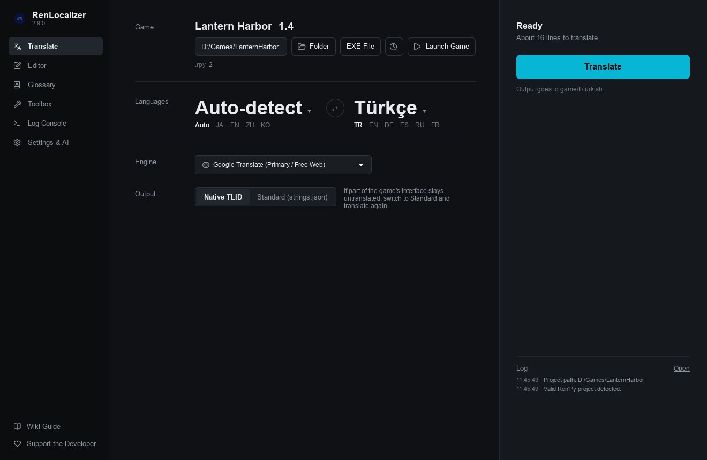
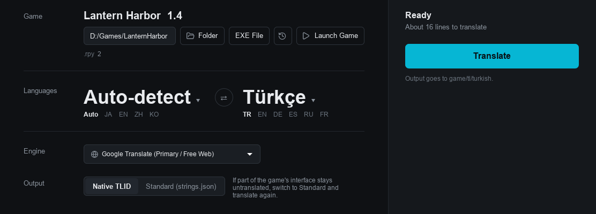
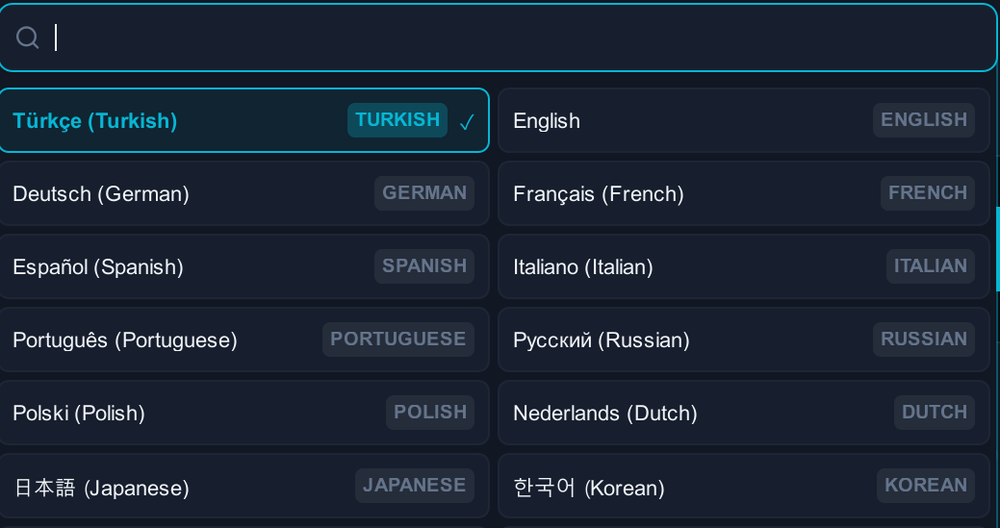
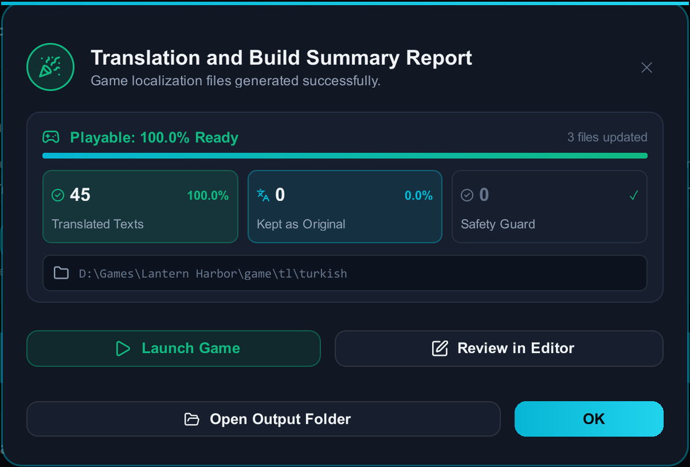
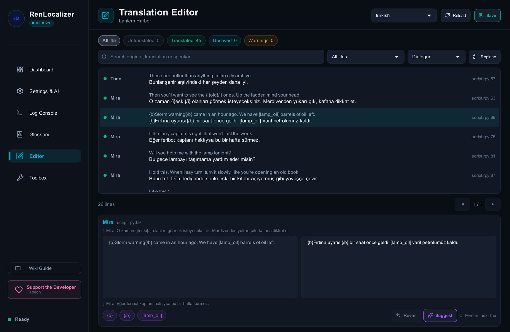

<p align="center">
  
</p>

<h1 align="center">RenLocalizer</h1>

<p align="center">
  <b>Play any Ren'Py visual novel in your own language.</b><br>
  Drop in the game, pick a language, press Start.<br>
  Free, open source, 135 languages, and the game keeps working.
</p>

<p align="center">
  <a href="https://github.com/Lord0fTurk/RenLocalizer/releases/latest/download/RenLocalizer-Windows-x64.zip"></a>
  <a href="https://github.com/Lord0fTurk/RenLocalizer/releases/latest/download/RenLocalizer-Linux-x64.AppImage"></a>
  <a href="https://github.com/Lord0fTurk/RenLocalizer/releases/latest/download/RenLocalizer-macOS-arm64.dmg"></a>
</p>

<p align="center">
  <a href="https://github.com/Lord0fTurk/RenLocalizer/releases"></a>
  <a href="https://github.com/Lord0fTurk/RenLocalizer/releases"></a>
  
</p>

<p align="center">
  <a href="#how-it-works">How it works</a> ·
  <a href="#which-engine-should-i-use">Engines</a> ·
  <a href="#why-your-game-keeps-working">Why it's safe</a> ·
  <a href="#questions">Questions</a> ·
  <a href="https://github.com/Lord0fTurk/RenLocalizer/wiki">Wiki</a> ·
  <a href="CHANGELOG.md">What's new</a>
</p>

<p align="center">
  
</p>

---

## How it works

No setup and no programming. Download, unzip, run.

<table>
  <tr>
    <td width="36%">
      <h3>1. Drop in your game</h3>
      Drag the game folder or its <code>.exe</code> onto the window, or use <b>Folder</b> / <b>EXE File</b>. RenLocalizer shows the game's name, version and Ren'Py version.
    </td>
    <td></td>
  </tr>
  <tr>
    <td>
      <h3>2. Pick a language</h3>
      Search 135 languages. Google Translate is selected by default and needs no account.
    </td>
    <td></td>
  </tr>
  <tr>
    <td>
      <h3>3. Translate and play</h3>
      Press <b>Start Translation</b>. When it finishes, click <b>Launch Game</b>. It opens in your language.
    </td>
    <td></td>
  </tr>
</table>

> [!TIP]
> Game got an update? Run it again. Lines that were already translated are reused, and only the new ones are sent for translation.

---

## Which engine should I use?

| If you want… | Use | What you need |
| :--- | :--- | :--- |
| **Free and instant** | Google Translate or Bing | Nothing. Both work without an account or key. |
| **The best quality** | DeepSeek, Gemini or OpenAI | An API key from that service. DeepSeek costs very little; Gemini has a free tier. |
| **Offline and private** | Local LLM | A `.gguf` model file, or Ollama / LM Studio. Nothing leaves your computer. |

AI engines read lines as a scene, with who is speaking to whom, so tone, gender and relationships stay consistent.

<details>
<summary><b>All engines compared</b></summary>
<br>

| Engine | Needs | Cost | Notes |
| :--- | :--- | :--- | :--- |
| Google Translate | Nothing | Free | The default. Rotates between several endpoints to avoid limits. |
| Bing / Microsoft Edge | Nothing | Free | Separate from Google's limits; falls back to Google if it fails. |
| DeepSeek | API key | Low | Strong quality for the price. |
| Google Gemini | API key | Free tier / paid | Large context window. |
| OpenAI | API key | Paid | Also works with any OpenAI-compatible service (OpenRouter and others) through a custom base URL. |
| Local LLM, built-in runner | A `.gguf` file | Free | RenLocalizer downloads and runs llama.cpp for you. No other install. |
| Local LLM, Ollama / LM Studio | The app running | Free | Uses the model you already have loaded. Includes a profile for translation models such as Hy-MT. |
| LibreTranslate | Your own server | Free | Self-hosted. |

</details>

---

## Why your game keeps working

Most translation tools treat a Ren'Py script like plain text, and the game crashes on the first broken tag. RenLocalizer is built around not breaking anything.

<table>
  <tr>
    <td width="50%" valign="top">
      <b>Code stays code</b><br>
      Text tags like <code>{b}</code> and <code>{color=…}</code> and variables like <code>[player_name]</code> are locked before translation and checked afterwards. A line that comes back broken is retried; if it still fails, the original is kept instead of crashing the game.
    </td>
    <td width="50%" valign="top">
      <b>Real Ren'Py translation files</b><br>
      Writes the standard <code>game/tl/</code> files, with the same line IDs Ren'Py's own translation generator produces. No duplicate-string errors.
    </td>
  </tr>
  <tr>
    <td valign="top">
      <b>Packed and compiled games</b><br>
      Reads compiled <code>.rpyc</code> scripts when there is no source, and unpacks <code>.rpa</code> archives, including some custom-protected ones.
    </td>
    <td valign="top">
      <b>Every script, every direction</b><br>
      Fonts that show empty boxes can be swapped for one that covers your language, and Arabic, Persian and Hebrew are shown right-to-left.
    </td>
  </tr>
  <tr>
    <td valign="top">
      <b>Names stay names</b><br>
      Character names are left alone by default, and a glossary keeps your own terms the same in every line.
    </td>
    <td valign="top">
      <b>You have the last word</b><br>
      The built-in editor lists every line with its original. Search, filter, fix, or ask for a fresh suggestion; your edits are kept by later runs.
    </td>
  </tr>
</table>

<p align="center">
  
</p>

---

## Questions

<details>
<summary><b>The game still starts in English.</b></summary>
<br>

**Settings › General & Output › Start the game in the translated language** is on by default and adds a small file that switches the game at launch. If you turned it off, or the game forces its own language, open **Toolbox › Language Activation** and pick your language. Games with their own language menu also list it under Preferences.
</details>

<details>
<summary><b>Some lines are still in English.</b></summary>
<br>

Character names, sound effects and short exclamations are often the same in every language, so they are kept as they are. The summary at the end shows how many lines were translated, kept, or held back to protect the game. Open the editor to translate any of them by hand. To translate speaker names too, turn on **Settings › General & Output › Translate Character & Speaker Names**.
</details>

<details>
<summary><b>Does it change my game files or saves?</b></summary>
<br>

Your saves are not touched. RenLocalizer writes the translation to `game/tl/<language>/` and adds a few small files starting with `zzz_` in `game/`. If the game's scripts are packed in `.rpa` archives, they are unpacked and the archives are removed to save disk space.

> [!IMPORTANT]
> Keep a copy of the game folder before your first translation, especially for games that use `.rpa` archives.

To remove a translation, delete `game/tl/<language>/` and the `zzz_` files RenLocalizer added.
</details>

<details>
<summary><b>Windows warns me, or my antivirus flags the app.</b></summary>
<br>

The app is not code-signed, so Windows SmartScreen may show a warning: click **More info › Run anyway**. Some antivirus programs flag apps packaged with PyInstaller by mistake. The source code is open, and you can [run it from source](#for-power-users) instead.
</details>

<details>
<summary><b>macOS says the app is damaged or can't be opened.</b></summary>
<br>

The macOS download needs an **Apple Silicon Mac (M1 or later) running macOS 13 or newer**. On an Intel Mac, [run it from source](#for-power-users). To check your chip, open the Apple menu › About This Mac.

macOS blocks apps that are not notarized. Move RenLocalizer to Applications, then do one of these:

- **macOS 15 Sequoia:** open the app once, then go to **System Settings › Privacy & Security**, scroll down and click **Open Anyway**. Control-click › Open no longer works on Sequoia.
- **Any version:** run this once in Terminal, then open the app normally:

```bash
xattr -cr /Applications/RenLocalizer.app
```

If it still does not open, [report it](https://github.com/Lord0fTurk/RenLocalizer/issues) with your macOS version, your chip and the exact message.
</details>

<details>
<summary><b>Which games work?</b></summary>
<br>

Games made with Ren'Py 7 or 8 on Windows, Linux and macOS, including macOS `.app` games, games that ship only compiled `.rpyc` files, and games packed in `.rpa` archives.
</details>

More help is in the [Wiki](https://github.com/Lord0fTurk/RenLocalizer/wiki). Found a bug? [Open an issue](https://github.com/Lord0fTurk/RenLocalizer/issues).

---

## For power users

<details>
<summary><b>Command line</b></summary>
<br>

The release includes `RenLocalizerCLI` next to the app. From source, use `python run_cli.py`. It reads the same settings as the app; flags override them.

```bash
# Translate to Turkish with Google (the defaults)
python run_cli.py translate "C:\Games\MyVisualNovel\game.exe"

# Translate to Russian with DeepSeek
python run_cli.py translate "C:\Games\MyVisualNovel\game.exe" -e deepseek -t ru --api-key YOUR_KEY

# Translate to German with a local model, scanning deeper for hidden strings
python run_cli.py translate "C:\Games\MyVisualNovel\game.exe" -e local_llm -t de --deep-scan

# Make the game start in an already translated language
python run_cli.py activate-language "C:\Games\MyVisualNovel" --lang turkish

# Step-by-step menu
python run_cli.py --interactive
```

Run `python run_cli.py translate --help` for every option.
</details>

<details>
<summary><b>Run from source</b></summary>
<br>

Requires Python 3.10 or newer.

```bash
git clone https://github.com/Lord0fTurk/RenLocalizer.git
cd RenLocalizer
python -m venv .venv
```

Activate the environment: `.venv\Scripts\activate` on Windows, `source .venv/bin/activate` on Linux and macOS. Then:

```bash
pip install -r requirements.txt
python run.py
```
</details>

<details>
<summary><b>How the protection works</b></summary>
<br>

- **Placeholders:** before a line is sent, Ren'Py syntax is swapped for placeholders the engine leaves alone: Unicode bracket tokens for Google and Bing, `<ph id="N">` tags for AI engines.
- **Restoration:** placeholders are put back in several passes, from exact matches to repairs of tokens an engine changed or moved. Text tags that come back in the wrong order are swapped back when that is safe.
- **Integrity check:** a line with missing placeholders, leaked tokens, mismatched `%` specifiers or tags Ren'Py would refuse is retried, then kept in the original.
- **Batch formats for AI:** scene (with speakers), JSON, XML, or one line per request for small and translation-only models.
- **Output modes:** native Ren'Py `translate` blocks (default), or a `strings.json` file read by a small runtime hook.
</details>

---

## Support the project

RenLocalizer is free and built in spare time. If it saved you an evening, you can help:

- Star the repository, so others can find it.
- [Support the developer on Patreon](https://www.patreon.com/cw/LordOfTurk).
- Report bugs and ideas in [Issues](https://github.com/Lord0fTurk/RenLocalizer/issues), or read [CONTRIBUTING.md](CONTRIBUTING.md) to send a change.

---

## License and credits

RenLocalizer is released under the [GNU General Public License v3.0](LICENSE).

It builds on these open-source projects:

| Project | License | Used for |
| :--- | :---: | :--- |
| [llama.cpp](https://github.com/ggml-org/llama.cpp) | MIT | Built-in GGUF runner. The official `llama-server` build is downloaded on request (verified by SHA256) and managed by RenLocalizer; it is **not** bundled with the release. |
| [PyQt6 / Qt](https://www.qt.io) | GPL-3.0 / LGPL-3.0 | Desktop interface (QML) |
| [Lucide](https://lucide.dev) | ISC | Interface icons. A subset of the Lucide icon font ships in `src/gui/qml/fonts/` with its license (`LUCIDE_LICENSE.txt`). |
| [unrpa](https://github.com/Lattyware/unrpa) | GPL-3.0 | `.rpa` archive extraction |
| [rpycdec](https://pypi.org/project/rpycdec/) | MIT | Complementary `.rpyc` decompilation |
| [rich](https://github.com/Textualize/rich) | MIT | Command-line interface |

Translation engines are used through their public endpoints or official SDKs (Google Translate, Microsoft Translator via the Edge endpoint, LibreTranslate, OpenAI, Google Gemini, DeepSeek).
