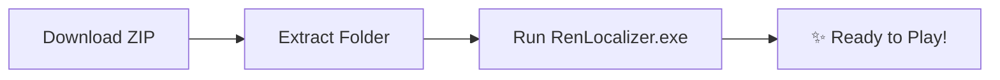

# 📥 Installation Guide

Getting RenLocalizer up and running takes less than a minute. No complicated setup or developer environment required.

---

## 🪟 Windows (Recommended)



1. Go to the [**Releases page**](https://github.com/Lord0fTurk/RenLocalizer/releases).
2. Download the latest `RenLocalizer_vX.X.X_Windows.zip`.
3. Extract the ZIP anywhere (Desktop, Games folder, or USB drive).
4. Double-click `RenLocalizer.exe`.

> 💡 **Windows Defender:** If a "Windows protected your PC" popup appears, click **"More info" ➔ "Run anyway"**. RenLocalizer is 100% open-source and free of malware.

---

## 🐧 Linux

### Option A — AppImage (Portable)
```bash
chmod +x RenLocalizer-Linux-x64.AppImage
./RenLocalizer-Linux-x64.AppImage
```

### Option B — Run from Source
```bash
git clone https://github.com/Lord0fTurk/RenLocalizer.git
cd RenLocalizer
python3 -m venv .venv
source .venv/bin/activate
pip install -r requirements.txt
python run.py
```

---

## 🍎 macOS (Apple Silicon / ARM64)

1. Download the `RenLocalizer_vX.X.X_macOS_arm64.dmg` from [Releases](https://github.com/Lord0fTurk/RenLocalizer/releases).
2. Open the DMG and drag **RenLocalizer.app** into your **Applications** folder.
3. Because the DMG is ad-hoc signed, Gatekeeper might say the app is "damaged" or "cannot be opened". Open **Terminal** and run this command once:
   ```bash
   xattr -cr /Applications/RenLocalizer.app
   ```
4. Double-click the app to launch!

---

## 🖥️ Single-Page Dashboard Overview

When you launch RenLocalizer, everything you need is visible on a single responsive screen:

```
┌─────────────────────────────────────────────────────────────┐
│  RenLocalizer v2.8.15                [EN ▼] [🎨 Theme] [⚙️]  │
├─────────────────────────────────────────────────────────────┤
│  📂 Project Selection: [ Browse Game Folder / EXE ]         │
├─────────────────────────────────────────────────────────────┤
│  🌐 Engine: [ Google Translate ▼ ]   Language: [ Turkish ▼] │
│  🎭 Mode:   [ 🎭 Scene Mode (Context-Aware) ▼ ]             │
├─────────────────────────────────────────────────────────────┤
│  🤖 AI Engine & Model Configuration (API Keys / Ollama)    │
├─────────────────────────────────────────────────────────────┤
│  📋 Live Activity Log & Progress Bar                        │
│  [ ▶ START TRANSLATION ]                                    │
└─────────────────────────────────────────────────────────────┘
```

> 💡 **100% Portable:** Your preferences are automatically saved in `config.json`. You can move the folder to another PC or a USB drive without losing your settings.

---

## ➡️ Next Step: [[Quick-Start]]
